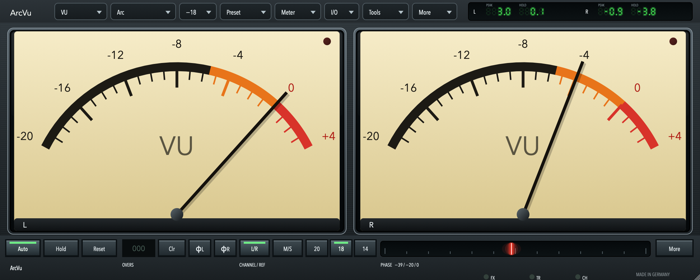
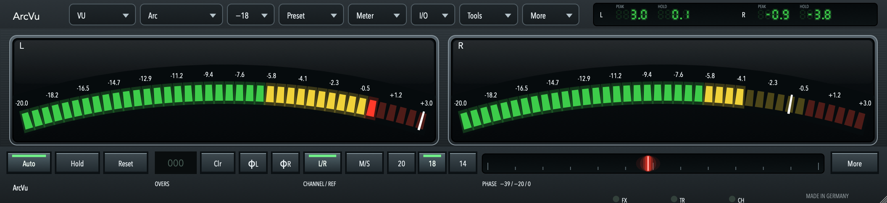
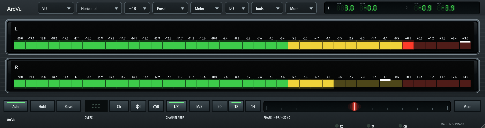
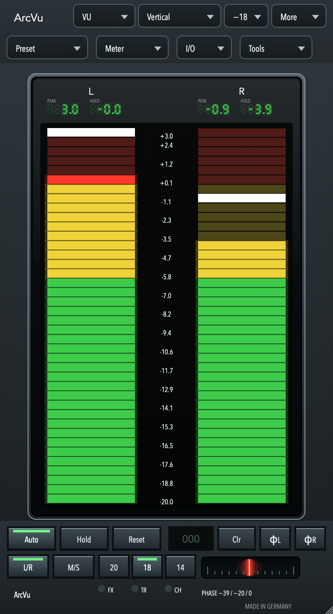
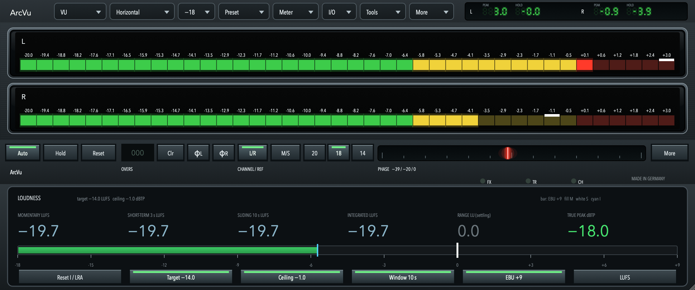
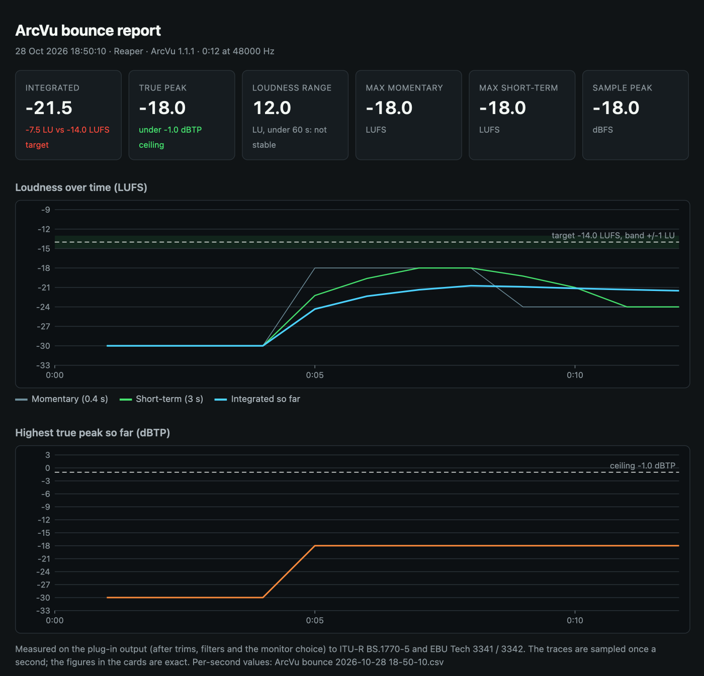
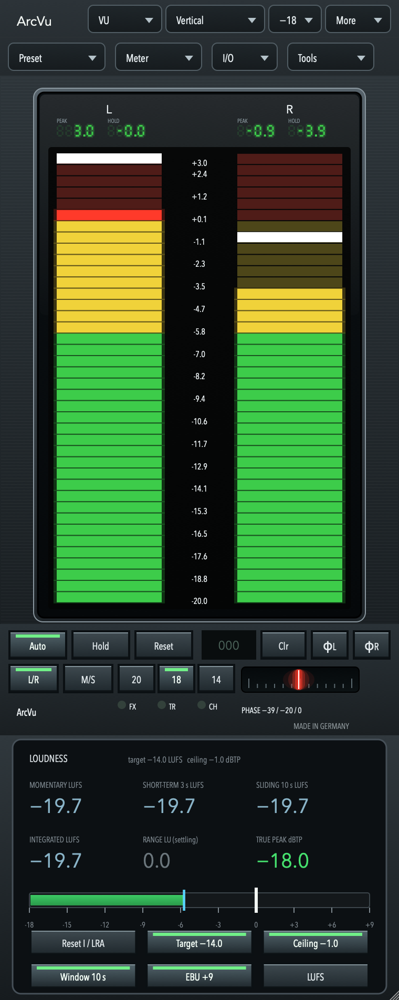

# ArcVu

**A digital analogue meter by OpenGrid.** ArcVu shows your signal as a VU, RMS, K-System or peak programme (PPM) meter on analogue needle dials or lamp meters, and adds a standards-based loudness panel and an offline bounce report. The audio passes through unchanged.



| Modern lamp skin | Classic needle skin |
|---|---|
|  |  |

Three faces share the same meters: **Arc**, **Horizontal** and **Vertical**, each in three colours (Graphite/Ivory, Amber, Ice).

| Horizontal | Vertical |
|---|---|
|  |  |

## New in 1.0

- **Loudness panel.** Momentary, short-term, a sliding window you choose (10 s by default), integrated, loudness range and true peak, measured to ITU-R BS.1770-5 and checked against the EBU Tech 3341 and 3342 test signals. Choose any target and true-peak ceiling, the EBU +9 or +18 scale, and LUFS or LU.
- **Offline bounce log.** When the host renders offline, ArcVu writes a loudness summary, a visual HTML report with charts, and a per-second CSV of what it output.
- **Peak scale.** The digital PEAK number can read in dBFS, so 0 dBFS is 0 on every meter type.



| The offline bounce report | Loudness on the Vertical face |
|---|---|
|  |  |

See the [changelog](CHANGELOG.md).

## Download

ArcVu **1.0.0** is in preparation. The macOS installer (VST3, Audio Unit, CLAP, LV2, AAX and Standalone), the Windows and Linux packages and the PDF manual will be on the [Releases page](https://github.com/MistaMin/ArcVu/releases) when it is published.

## Quick start

1. Install ArcVu and put it **last** in the channel or on the master bus. It appears as **ArcVu** by **OpenGrid**.
2. Choose a **meter type** (VU, RMS, K-12, K-14, K-20, DIN, Nordic, BBC or EBU) and a **reference level** (−20, −18 or −14 dBFS) in the header.
3. For loudness, open **More > Display** and switch on **Loudness panel**. Set the target you deliver to.
4. Bounce as usual. The report appears in `Documents/ArcVu Bounce Logs`.

## Features

- **Nine meter types.** VU (IEC 60268-17), RMS (absolute dBFS, AES-17 option), K-12/K-14/K-20, and the DIN, Nordic, BBC and EBU peak programme meters. The EBU meter follows Tech 3205-E and has a slow mode.
- **Two skins, three faces, three colours.** Analogue needle dials for every meter type, or 40-lamp meters, on the Arc, Horizontal or Vertical face. Resize the window freely; the face keeps its proportions.
- **Digital PEAK and HOLD readout**, held for a time you choose, and a glowing phase correlation line.
- **Loudness panel and bounce log**, described above.
- **Tools** for monitoring: trims, polarity and mute, mid/side, monitor selection, high-pass and low-pass, a mono maker and a dynamic filter.
- **Formats.** VST3, Audio Unit, CLAP, LV2, AAX (macOS) and Standalone on macOS; VST3, CLAP, LV2 and Standalone on Windows and Linux.

## User guide

See the [User Manual](docs/USER_MANUAL.md) for the interface, every meter type, the loudness panel, the bounce log and a reference of all 55 parameters. The [release process](docs/RELEASE.md) describes how the packages are built and signed.

## How it measures

- **VU.** Full-wave rectify, then scale by π / (2√2) so a steady sine reads its RMS level. A second-order movement (damping 0.82, ωn 14 rad/s) reaches about 99% in 300 ms and overshoots by about 1%. Rise and fall are the same movement.
- **Reference.** 0 is the level of a sine whose sample peak is the reference: −20, −18 or −14 dBFS (default −18). A 1 kHz sine at that peak sits on 0 and its peak tick near +3.
- **PPM.** Release follows ITU-R BS.645-2 Table 1: DIN and Nordic 20 dB in 1.7 s, BBC 26 dB in 3 s, EBU 24 dB in 2.8 s. The EBU attack is fitted to Tech 3205-E.
- **Loudness.** K-weighting and gating to ITU-R BS.1770-5, time scales per EBU Tech 3341, loudness range per Tech 3342, true peak by 4× oversampling (BS.1770 Annex 2). The code is in `dsp/src/loudness.rs`.

The detector and the drawing list are Rust (`dsp/`), using GoodLookinDri's segment arc and metal knob. JUCE hosts the plug-in and replays the drawing list. `cargo test --manifest-path dsp/Cargo.toml` runs the detector and loudness tests.

## Build

```sh
git clone https://github.com/MistaMin/ArcVu.git
cd ArcVu
cargo test --manifest-path dsp/Cargo.toml
cmake -S . -B build -DCMAKE_BUILD_TYPE=Release
cmake --build build --target ArcVu_VST3 -j 8
```

Rust (`cargo`) and a JUCE checkout are required; see [qa/PROJECT.md](qa/PROJECT.md) for the repeatable QA commands.

## Quality checks

The QA records are in [qa/](qa/): the [release QA ledger](qa/2026-10-26-release-qa/ledger.md) (host suite in a hidden REAPER, auval, unit tests, UI audit) and the [loudness and bounce log ledger](qa/2026-10-28-loudness/ledger.md), which lists what was verified and what was not run.

## Licence

ArcVu is released by OpenGrid. See [LICENSE](LICENSE), [BINARY_LICENSE.txt](BINARY_LICENSE.txt) and [THIRD_PARTY_LICENSES.md](THIRD_PARTY_LICENSES.md). JUCE is used under its commercial licence for the official binaries. The AAX plug-in uses the Avid AAX SDK. AAX and Pro Tools are trademarks of Avid Technology, Inc.
