# ArcVu 1.0 User Manual

ArcVu is a digital analogue meter by OpenGrid. It shows the level of your signal as a VU, RMS, K-System or peak programme (PPM) meter, with analogue-style needle dials (Classic skin) or lamp meters (Modern skin). The audio passes through ArcVu unchanged unless you switch on one of the monitoring tools.

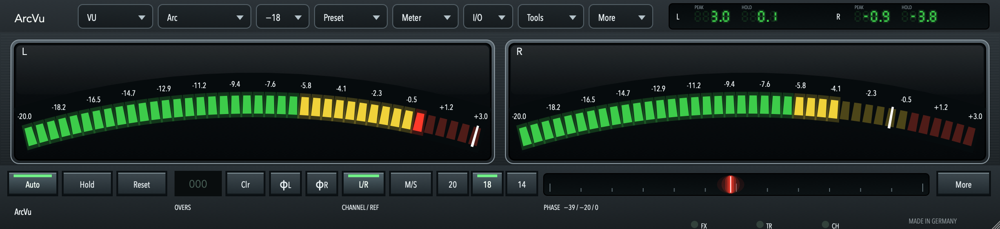

<!-- TOC -->

## Quick start

1. Put ArcVu **last** in the channel or on the master bus, so it measures what you hear and what you bounce.
2. Pick a **meter type** and a **reference level** in the header bar. For a mix, VU at -18 is a good start; for broadcast, choose EBU or DIN.
3. For loudness, open **More > Display** and switch on **Loudness panel**, then set the **target** you deliver to (for example -14 LUFS for streaming, -23 for broadcast).
4. Bounce or export as usual. When the host renders offline, ArcVu writes a report to `Documents/ArcVu Bounce Logs`.

> **Tip.** Everything here is saved with your project except the interface settings (skin, colour, window size, loudness panel and bounce log settings), which are shared by all instances and kept in your user folder.

## Installing

ArcVu comes as VST3, Audio Unit, CLAP, LV2 and AAX plug-ins and a Standalone application (macOS), and as VST3, CLAP, LV2 and Standalone for Windows and Linux. The macOS installer puts the plug-ins in the system plug-in folders. In Pro Tools, ArcVu is an AAX plug-in signed for Pro Tools. The plug-in appears as **ArcVu** by **OpenGrid** in the Dynamics/Analyzer group of your host.

## The interface

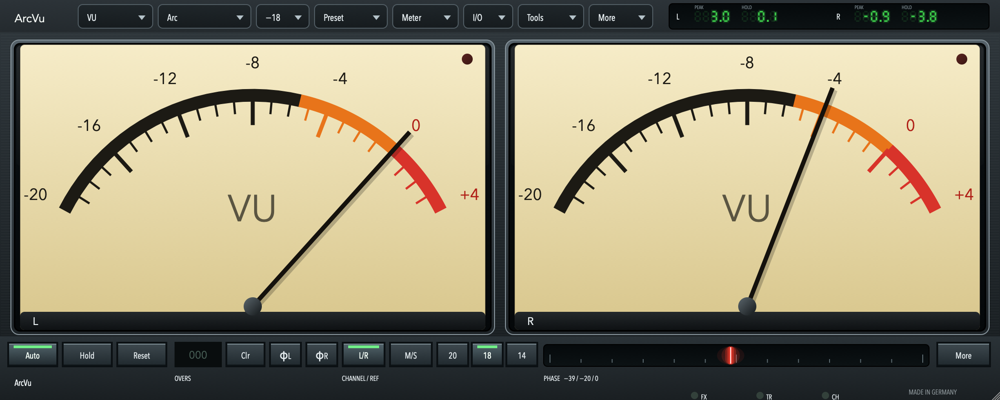

The header bar holds the menus. From left to right: the **meter type**, the **face**, the **reference level**, **Preset**, **Meter**, **I/O**, **Tools** and **More**. On the wide faces the digital PEAK/HOLD display sits at the right end of the header.

- **Faces.** *Arc* (two dials or arc meters side by side), *Horizontal* (two bars one above the other) and *Vertical* (two tall bars side by side with a shared scale).

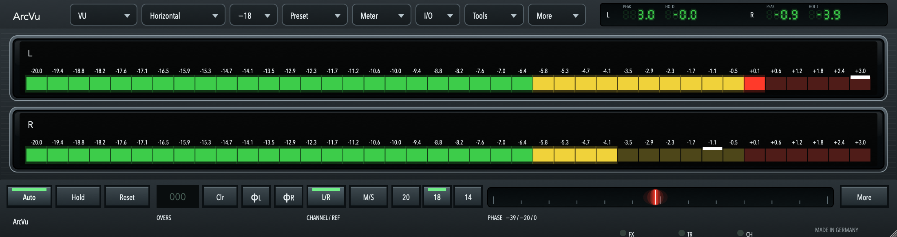
- **Skin** (More > Display). *Modern* draws 40-lamp meters. *Classic* draws analogue needle dials for all nine meter types.
- **Colour** (More > Display). Graphite/Ivory, Amber (a dark dial with orange markings in Classic) and Ice. Skin and colour are saved with your interface settings, not with presets or projects.
- **Peak scale** (More > Display). *Meter scale* shows the digital PEAK number relative to the meter's own zero (the reference level on VU and PPM, the K zero on K meters). *dBFS* shows the sample peak against full scale, so 0 dBFS reads 0 on every meter type; the label then reads PEAK FS. HOLD always follows the meter scale. The choice is saved with your interface settings.
- **Size.** Drag the window corner to any size; the face keeps its proportions and ArcVu remembers the size. The 100%, 125% and 150% choice in the Display menu jumps to those sizes.
- **Digital readout.** PEAK and HOLD are shown as green seven-segment numbers. They stay on screen for the *Value hold* time (Meter menu, 5 seconds by default; set it from 0 to 30 seconds, or to -1 to hold until reset) so you can read them. The Values and Hold switches in the Display menu show or hide them.
- **Phase line.** A glowing line moves from out of phase (left) to mono (right). It turns red when the channels are mostly out of phase.
- **Keys row.** *Auto* makes the white peak lamp hold for the Peak hold time and then fall, *Hold* keeps it until you reset it, and with neither on (Follow) it follows the signal without holding. *Reset* clears peaks, the *OVERS* counter counts samples at or above full scale and *Clr* clears it, the polarity keys invert one channel for metering, *L/R* and *M/S* choose the channel mode, and *20*, *18* and *14* set the reference level in dBFS. The small lamps FX, TR and CH light when the processing tools, trims, or polarity/mute are active.
- **Single mode.** With Single on, the first meter shows the sum of both channels. The interface does not change: the second meter shows OFF.

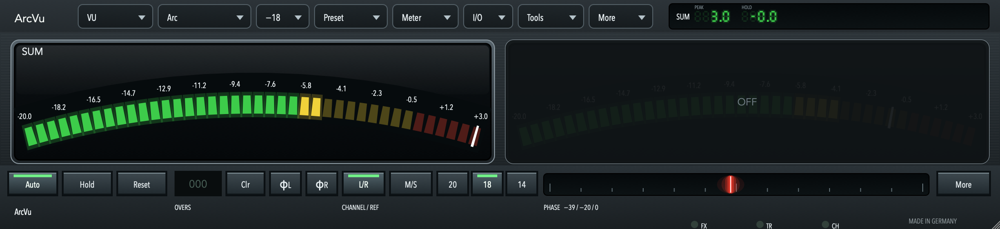

## Meter types

| Type | What it shows |
|---|---|
| VU | The classic 300 ms ballistic (IEC 60268-17). 0 is the reference level. |
| RMS | RMS level in dBFS. With AES-17 on (the default) a full-scale sine reads 0 dBFS; turn it off for pure RMS (3 dB lower). |
| K-12, K-14, K-20 | RMS relative to the K-System reference: 0 on the dial is -12, -14 or -20 dBFS RMS. The dial prints the reference under its title. |
| DIN, Nordic, BBC, EBU | Quasi-peak programme meters. Release times follow ITU-R BS.645-2 (DIN and Nordic 20 dB in 1.7 s, BBC 26 dB in 3 s, EBU 24 dB in 2.8 s). The EBU meter follows EBU Tech 3205-E (type IIb), has a slow mode (Preset menu), and shows TEST at 0 as on EBU scales. |

The **reference level** (-20, -18 or -14 dBFS) is the level of a sine whose sample peak is at that value; the VU meter reads 0 there. The VU dial runs from -20 to +4 in whole numbers.

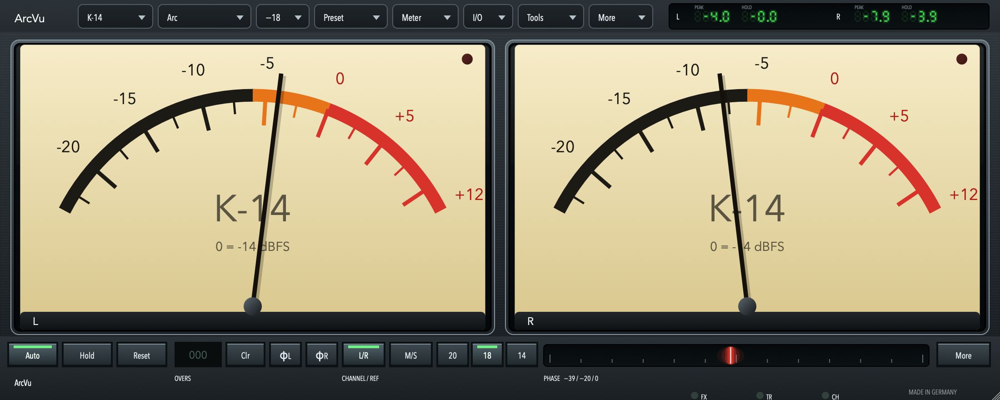

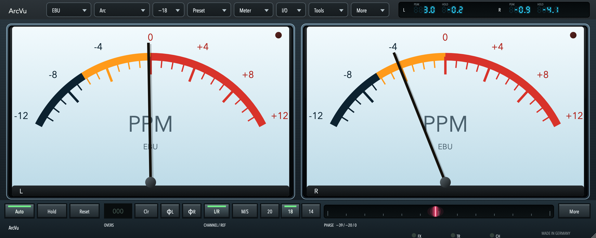

## Reading levels

The needle or lamp bar follows the meter's own ballistic. The white lamp (Modern) shows sample peak. A red lamp shows clipping. The digital PEAK number is the highest peak since it was last reset or since the Value hold time ran out, and HOLD is the highest meter reading held the same way. On VU and the PPM types both are in dB relative to the reference, unless the Peak scale is dBFS, which measures PEAK against full scale.

## Loudness

Switch on **Loudness panel** (More > Display) to add a loudness readout under the face. It measures the input with the ITU-R BS.1770-5 K-weighting and follows the EBU Tech 3341 time scales and the EBU Tech 3342 loudness range.

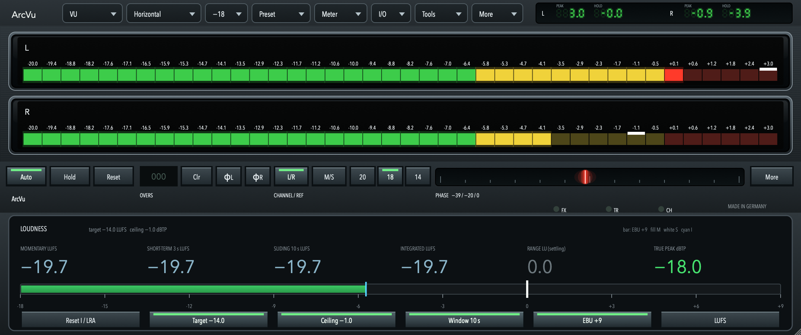

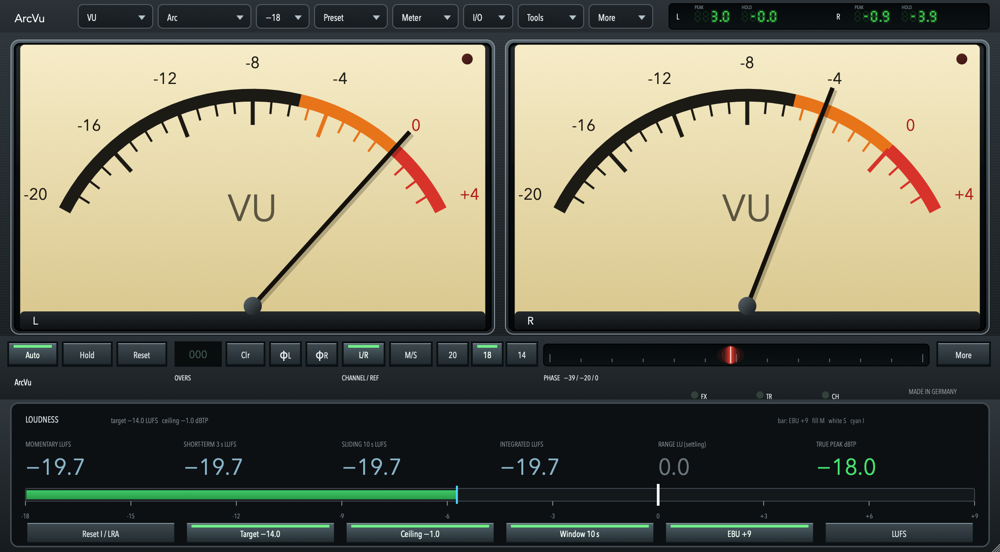

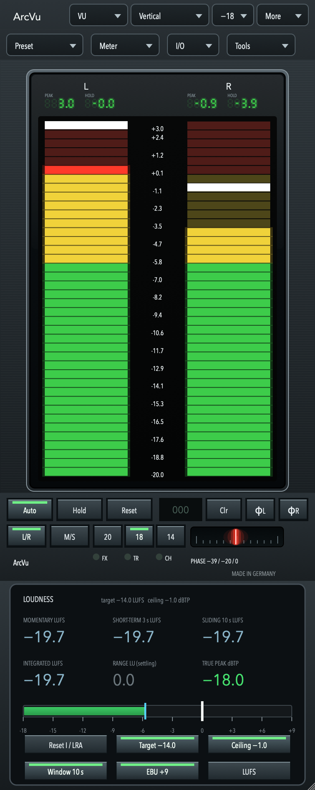

- **Momentary** is the last 0.4 s and **Short-term 3 s** the last 3 s; neither is gated. **Sliding** is a third window you choose, 1 to 30 s (10 s by default). It is not a BS.1770 or EBU time scale and is not gated.
- **Integrated** is the loudness of everything since the last reset, using the BS.1770 gates (absolute −70 LUFS, relative −10 LU). **Loudness range** (LRA) is the spread of the 3 s values between the 10th and 95th percentile (gates −70 LUFS and −20 LU). The LRA is marked *settling* until 60 s have been measured.
- **True peak** is the highest inter-sample peak since the reset, from the 4× oversampling of BS.1770 Annex 2, in dBTP. It is red above the ceiling.
- The numbers are green within ±1 LU of the **target**, amber up to 3 LU over, red beyond that, and blue-grey below it. Choose any target in Display (−40 to −5 LUFS); the Target button steps through −23 (EBU R128 broadcast), −18, −16 (podcasts and some streaming) and −14 (most streaming services). The Ceiling button steps the true-peak limit through −1, −2 and −3 dBTP. Streaming services change their targets from time to time: check the one you deliver to.
- The bar shows the loudness against the target (0 in the middle of the scale) on the **EBU +9** scale (−18 to +9 LU) or the **EBU +18** scale (−36 to +18 LU). The fill is momentary, the white tick short-term and the cyan tick integrated. **LUFS | LU** switches the numbers between absolute LUFS and LU relative to the target.
- **Reset I / LRA** clears the integrated loudness, the range, the maxima and the true peak. A stereo input is measured as left plus right with weight 1 each; a mono input is one channel, as BS.1770 defines it, so it reads 3 dB below the same signal on both channels.
- The loudness is measured on the input before the trims, polarity, mute, filters and monitor choices. The panel's settings are interface settings kept with the skin and colour, not in presets or projects, and they add no host parameters.

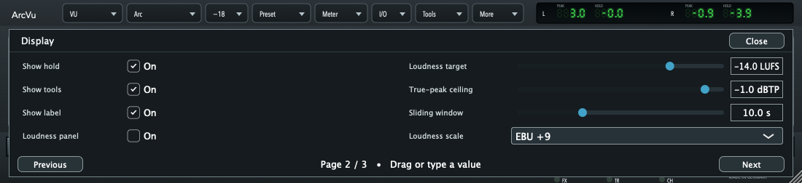

> **Tip.** A target is a goal, not a limit. Streaming services change their targets from time to time, so check the one you deliver to. A track that measures -14.3 LUFS integrated is within the usual ±1 LU of a -14 target.

## Offline bounce log

When the host renders offline (a bounce, export or freeze that runs faster than real time), ArcVu measures what it outputs and, when the render ends, writes three files to the **ArcVu Bounce Logs** folder in your Documents folder:

- `ArcVu bounce <date> <time>.txt` is a summary: the host, the length and sample rate, then integrated loudness, loudness range, maximum momentary and short-term, true peak and sample peak, and how the integrated loudness and true peak compare with the target and ceiling set in the loudness panel.
- `ArcVu bounce <date> <time>.html` is the visual report: open it in any browser. It shows the headline figures as cards (green or red against your target and ceiling), a chart of momentary, short-term and integrated loudness over time with the target and its ±1 LU band, and a chart of the highest true peak so far against the ceiling.
- `ArcVu bounce <date> <time>.csv` has one row per second (seconds, momentary, short-term, integrated, true peak), for a spreadsheet. The charts and the CSV are sampled once a second; the figures in the summary and the cards (maxima, true peak, integrated) are measured on every sample and are exact.

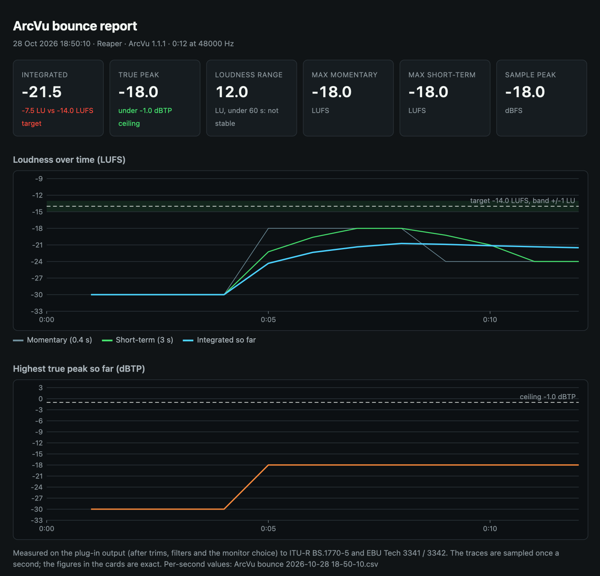

The figures are measured on the plug-in's output, after the trims, filters and monitor choice, with the same BS.1770-5 method as the panel. The log does not need the loudness panel to be on. Put ArcVu last in the chain, so the log describes the bounced file.

A render shorter than one second writes nothing, and a render that runs in real time is not logged. The log is written when the host releases the plug-in or stops sending audio, so a host that keeps the plug-in loaded can take up to two seconds to write it. Switch it off with **Bounce log** in More > Display. Hosts report offline rendering differently: if a host does not mark its bounce as offline, no log is written.

## Menus

**Preset.** Step through factory presets (Broadcast VU, K-14, DIN peak, Podcast -14), switch between Factory and User presets, copy and paste settings, save and load preset files, save your own default (Save default / Load default), save global settings (drag mode, drag sensitivity, refresh rate, tooltips), and turn on the EBU slow mode.

**Meter.** Peak lamp behaviour (Follow, Auto, Hold), Reset peak and Reset overs, the RMS window, AES-17, the VU model (Ideal 300 ms, Model 2, Custom), rise, fall, overshoot, peak hold, value hold, clip hold and clip threshold, the peak lamp threshold, the red zone, the comfort zone (K meters), analog RMS and the weighting filter.

**I/O.** Mid/side mode, trims for left, right, mid and side (with link), polarity, mute, the monitor selection (L, R, mid, side), Force mono and In place.

**Tools.** A dropdown of knobs. *High-pass* and *Low-pass* have a frequency and a slope (Off, 6, 12, 18 or 24 dB per octave). *Mono maker* narrows the side signal below its frequency by the amount you set. *Dynamic* is a band-limited downward gain with frequency, depth, type (high-pass, low-pass, narrow band, wide band), an on switch and a Listen switch to hear the band. Frequencies show at most three digits: 12.5 means 12.5 kHz, 380 means 380 Hz. The tools change what you monitor; with every tool off the audio is untouched.

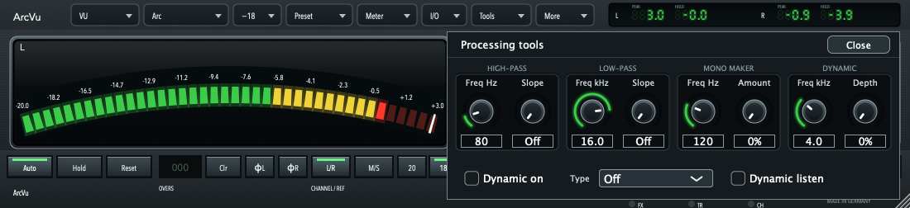

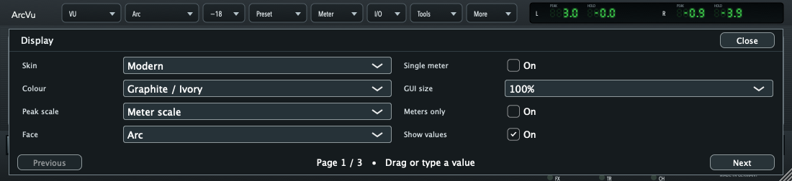

**More.** Display (face, skin, colour, peak scale, loudness panel and its target, ceiling, window, scale and unit, bounce log, size, Single, Meters only, and the Values, Hold, Tools and Label switches), Preferences (drag sensitivity, meter refresh rate, bypass of hidden processors, tooltips, stay above windows).

## Notes

> **Note.** ArcVu is a meter: the audio passes through unchanged unless you switch on one of the Tools (filters, mono maker, dynamic filter) or choose a monitor mode.

- **Meters only** hides the lower panel. With *Bypass hidden processors* on, the tools that are no longer visible are bypassed.
- **Label.** Click the label area under the keys to type a name for the instance (up to 31 bytes of text). It is stored with the project.
- **Latency and CPU.** ArcVu adds no latency. The metering runs in the audio thread without memory allocation; drawing happens in the editor.
- **State.** All settings are saved with the project. Skin, colour and window size belong to the interface settings and are shared by all instances.

<!-- PARAMETERS -->

## Standards and references

IEC 60268-17 (VU meter); ITU-R BS.645-2 (peak programme meters); EBU Tech 3205-E (type IIb PPM); ITU-R BS.1770-5 (programme loudness and true peak); EBU R 128, Tech 3341 (loudness metering) and Tech 3342 (loudness range); AES-17 (RMS level); K-System by Bob Katz; BS 6840-17.

## Licence and third-party software

ArcVu is released by OpenGrid. See `LICENSE` and `THIRD_PARTY_LICENSES.md`. JUCE is used under its commercial licence for the official binaries. The AAX plug-in uses the Avid AAX SDK. AAX and Pro Tools are trademarks of Avid Technology, Inc.
